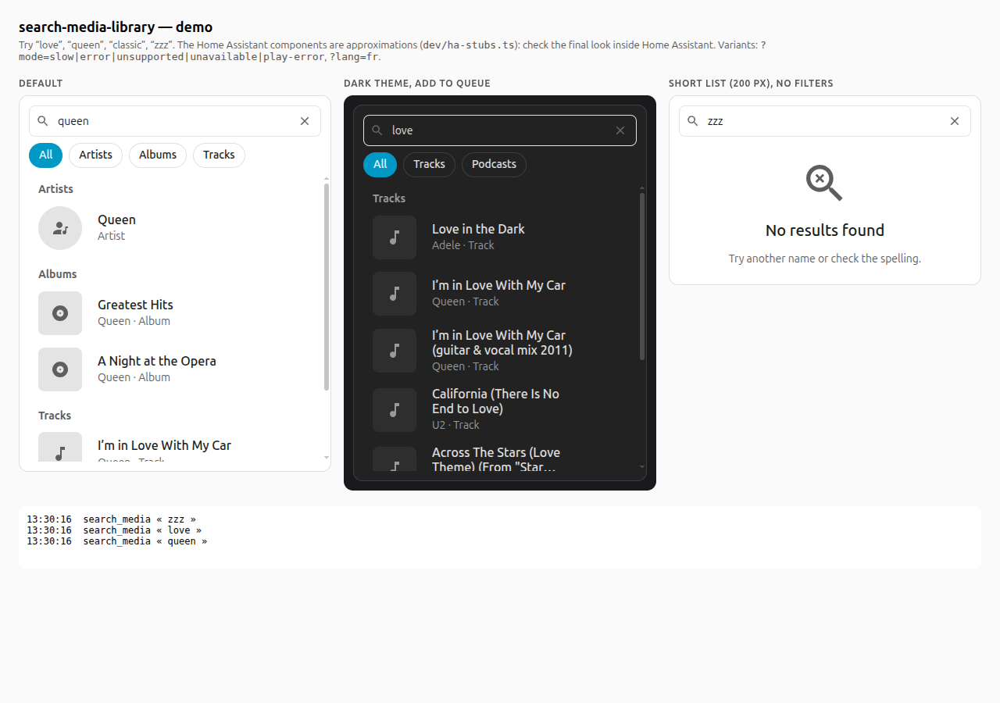

# Search media library

A Home Assistant dashboard card to **search your media library with live results** and play what you find on a media player. It follows the [Home Assistant design guidelines](https://contributors.home-assistant.io/design/): it uses the official `ha-input-search`, `ha-spinner`, `ha-skeleton` and `ha-alert` components and the `--ha-*` design tokens, so it looks native and follows your theme (light, dark or custom).



*The screenshot comes from the demo page (simulated data, approximated components). In Home Assistant the card uses the real components.*

## Features

- Search as you type (350 ms delay, 2 letters minimum), results grouped by type: radio stations, artists, albums, tracks, playlists, podcasts, audiobooks. Works with Music Assistant and Sonos players.
- Filter chips by type, thumbnails, "Artist · Track" subtitles.
- One tap plays the result on the chosen player (replace the queue, play now, play next or add to the queue).
- Loading skeleton, spinner after 500 ms, empty state, error alert, toast when playback fails.
- Visual editor, English and French, keyboard accessible, respects `prefers-reduced-motion`.
- Works in a dashboard, in a pop-up or in a dialog.

## Requirements

- **Home Assistant 2026.4 or newer** (the card uses the `ha-input` component).
- A media player that supports **`media_player.search_media`** (the `SEARCH_MEDIA` feature). The card tells you when the player does not support it.
- Tested with [Music Assistant](https://music-assistant.io/) and [Sonos](https://www.home-assistant.io/integrations/sonos/) (see below). Other integrations may return results in a different shape, or none; please open an issue with what you see.

## Supported players

| Integration | What you get |
| --- | --- |
| Music Assistant | Everything Music Assistant finds in one search: artists, albums, tracks, playlists, radio stations, podcasts, audiobooks, with artwork and "Artist - Title" names. |
| Sonos | The card runs one search per type (tracks, albums, artists, playlists), because the Sonos integration only searches one type at a time and defaults to tracks. Albums show their artist. Track names come **without** the artist (Home Assistant does not pass it on for Sonos). Artwork is served by the speaker itself and is missing for files without an embedded cover: the card then shows the type icon, but the browser still logs a 404 for that image. |

## Installation

### HACS (custom repository)

1. In HACS, open the menu → **Custom repositories**.
2. Add `https://github.com/modeclerck/search-media-library` with the type **Dashboard**.
3. Install **Search media library**, then reload your browser.

HACS registers the resource for you. If it does not, add it manually (**Settings → Dashboards → ⋮ → Resources**): URL `/hacsfiles/search-media-library/search-media-library.js`, type **JavaScript module**.

### Manual

1. Copy `dist/search-media-library.js` to `config/www/search-media-library/`.
2. Add the resource `/local/search-media-library/search-media-library.js` (type **JavaScript module**).

## Usage

Add the card from the card picker (**Search media library**) or in YAML:

```yaml
type: custom:search-media-library
entity: media_player.living_room
```

| Option | Default | Description |
| --- | --- | --- |
| `entity` | required | The `media_player` that searches and plays |
| `placeholder` | translated | Placeholder of the search field |
| `enqueue` | `replace` | On tap: `replace` (replace the queue and play), `play` (play now, keep the queue), `next` or `add` |
| `min_chars` | `2` | Letters needed before searching |
| `debounce` | `350` | Delay in ms after the last keystroke (YAML only) |
| `max_height` | `360` | Maximum height of the results list, in px |
| `show_filters` | `true` | Show the type filter chips |
| `autofocus` | `false` | Focus the field when the card is shown |

### In a pop-up

The card adapts to the width it is given. **Escape** clears the field first and only then closes the pop-up. It does not take the focus automatically (set `autofocus: true` if you want it, but note that it opens the keyboard on phones).

## Limitations

- A tap plays the result directly: there is no page to browse an artist or an album.
- Results are whatever the integration returns (Music Assistant returns a handful of items per type, not the whole library).
- Search results can include providers other than your local library (for example podcasts), depending on your setup.

## Development

```bash
npm install
npm run dev      # demo page on http://127.0.0.1:8765/dev/
npm run check    # type-check, tests, build
npm run build:dev  # dist-dev/search-media-library-dev.js
```

`npm run build:dev` builds the same card under another element name, `custom:search-media-library-dev` (shown as "Search media library (dev)"). Load it as an extra resource to try a change in Home Assistant next to the version installed by HACS: both can run on the same page.

`dev/ha-stubs.ts` approximates the Home Assistant components for the demo page and the tests: always check the final look inside Home Assistant. The committed bundle in `dist/` must be rebuilt (`npm run build`) before each commit.

## License

[MIT](LICENSE)
